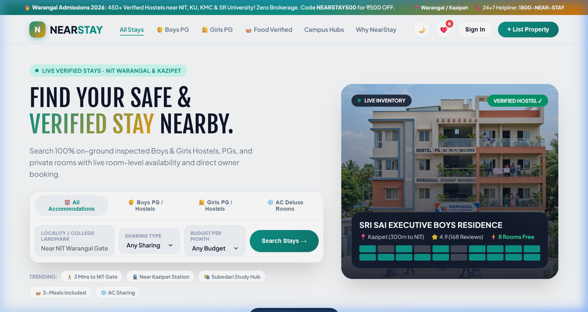
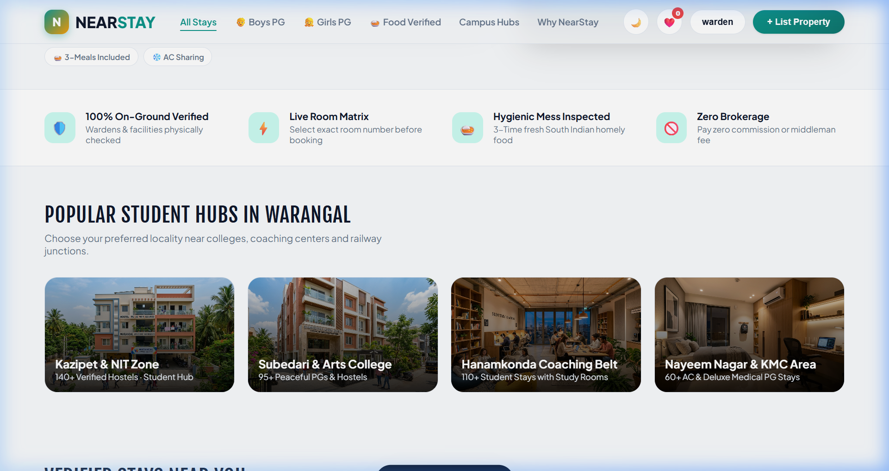
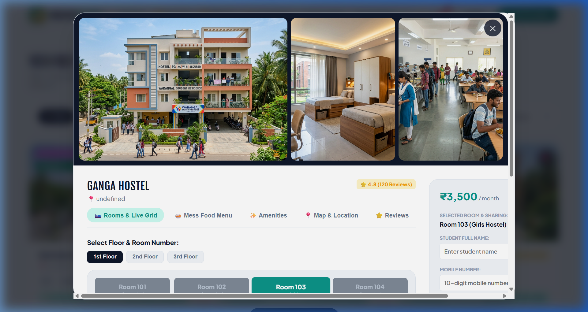
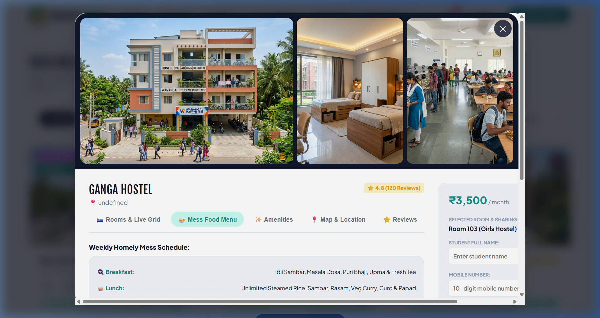
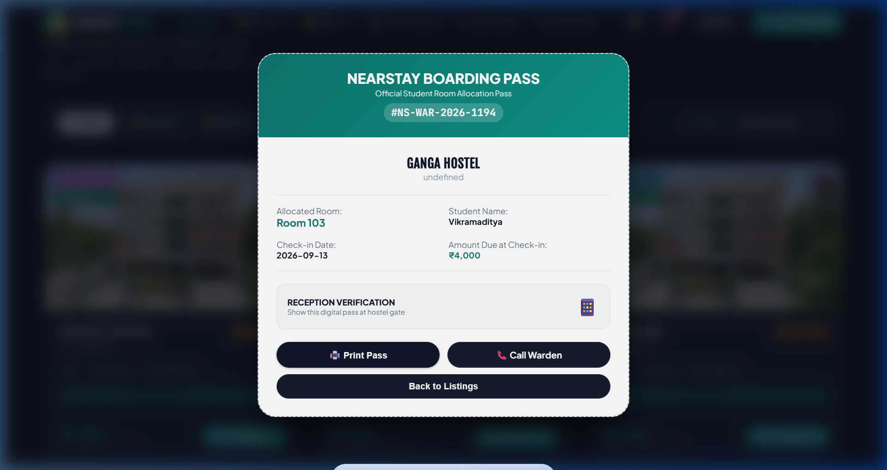
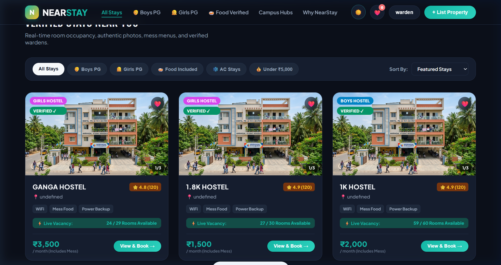

# 🏢 NEARSTAY — Complete Product & Technical Documentation

> **100% Verified Student Residences, PGs & Live Hostel Matrix Platform**  
> **Live Production URL:** [https://nearstay-74ad6.web.app](https://nearstay-74ad6.web.app)  
> **Target Launch Hub:** Warangal, Kazipet, Subedari, Hanamkonda & Expanding to Major Student Cities  

---

## 📌 1. What is NearStay? (Executive Summary)

**NearStay** is a dedicated student accommodation and hostel booking web platform engineered to solve the difficulties students, parents, and working professionals face when searching for accommodation near colleges, universities, and coaching centers.

Unlike general classifieds or map apps, NearStay is a specialized accommodation platform providing:
1. **Live Room-Level Vacancy Matrix**: Floor-by-floor interactive room grid showing exact vacant vs. occupied rooms in real-time.
2. **100% On-Ground Verified Stays**: Audited photos, genuine ratings, verified warden credentials, and certified biometric security for Girls Hostels.
3. **Weekly Inspected Mess Menus**: 7-day breakfast, lunch, snacks, and dinner schedule clearly listed before visiting.
4. **Zero Brokerage Guarantee**: Connect directly with property wardens without middleman cuts or commissions.
5. **Instant Official Digital Boarding Pass**: Locks the student's room with a verified allocation ticket, QR security badge, and 1-click print support.



---

## 🛑 2. The Problem with Traditional Hostel Hunting

Finding a hostel or PG in educational hubs like Warangal (near NIT Warangal, Kakatiya Medical College, Kakatiya University) has traditionally been exhausting and risky:

* **Physical Exhaustion & Time Waste**: Students and elderly parents spend days walking from lane to lane in scorching heat or rain, looking for "To-Let" signs and wall posters.
* **Hefty Brokerage Fees**: Local agents and middlemen charge students ₹1,000 to ₹3,000 just for showing addresses, with no accountability.
* **No Live Room Vacancy Visibility**: Students travel long distances only to discover that single or double sharing rooms are completely full.
* **Uninspected Food & Broken Promises**: Hostel owners often promise North/South Indian meals, high-speed WiFi, and 24/7 geysers, but reality is poor quality food and broken amenities.
* **Safety Concerns for Girls Hostels**: Female students and their parents have no reliable way to verify biometric security, resident wardens, and curfew rules in advance.

---

## ❓ 3. The Big Question: "Why NearStay when Google already exists?"

A common question is: *"Why do we need a separate website when we can just search on Google Maps or Google Search?"*

### The Fundamental Difference:
> **Google is a general search engine, NOT an accommodation booking & management system.**  
> Google Maps only shows a pin on a map with a random phone number. It does not manage room inventories, does not inspect kitchens, and cannot issue official room allocation passes.

### Detailed Comparison Table:

| Feature / Capability | Searching on Google / Maps | Using NearStay Platform |
| :--- | :--- | :--- |
| **Live Room Availability** | ❌ **None.** You must call or visit each building in person. | ✅ **YES.** Real-time floor & room matrix showing available vs occupied rooms. |
| **Weekly Mess / Food Menu** | ❌ No meal schedule or food transparency. | ✅ **YES.** Complete 7-day breakfast, lunch, snack, and dinner breakdown. |
| **Brokerage Commission** | ❌ High risk of reaching third-party brokers who charge fees. | ✅ **ZERO Brokerage.** Direct warden contact with fixed pricing. |
| **Official Allocation Pass** | ❌ None. Verbal promises only. | ✅ **YES.** Instant Digital Boarding Pass with QR verification. |
| **Girls Hostel Verification** | ❌ Unverified claims. | ✅ **YES.** 100% verified biometric gates, female wardens, and CCTV checks. |
| **Warden Live Inventory Control** | ❌ Wardens cannot manage bed-level occupancy. | ✅ **YES.** Wardens can toggle room availability in 1 click. |

```
💡 Summary in Simple Words:
Google tells you that a building exists.
NearStay tells you which room on which floor is vacant right now, what is being cooked for lunch on Wednesday, how much the exact rent is, and locks your room with an official confirmation pass.
```



---

## ⚡ 4. Key Platform Features & User Flows

### A. Smart Search Console & Quick Filters
Students can search by typing their college landmark (e.g., *"NIT Warangal"*, *"Kazipet"*, *"Subedari"*, *"Kakatiya Medical College"*) and filtering by:
* **Accommodation Type**: Boys PG / Hostel, Girls Safe Hostel, Co-living PG, and AC Deluxe Rooms.
* **Room Sharing**: Single occupancy, 2-sharing, or 3-sharing options.
* **Budget Per Month**: Under ₹4,500, ₹4,500 - ₹6,000, and Luxury ₹6,000+ brackets.
* **Trending Quick Chips**: 1-click filtering (*"3 Mins to NIT"*, *"Near Kazipet Station"*, *"Food Included"*).

### B. Interactive Live Room Grid (Floor Matrix)
When a student clicks any hostel card, a full-screen interactive modal opens displaying:
* **Floor Selector**: Switch between 1st Floor, 2nd Floor, and 3rd Floor.
* **Visual Color Codes**: Green rooms are available; dark slate rooms are occupied.
* **Instant Room Selection**: Clicking any green room (e.g., Room 103) highlights it in teal and updates the booking sidebar immediately.




### C. Transparent Weekly Mess Menu
NearStay displays the full weekly dining schedule audited during on-ground physical inspection:
* **🍳 Breakfast**: Idli Sambar, Masala Dosa, Puri Bhaji, Upma & Fresh Tea.
* **🍛 Lunch**: Unlimited Steamed Rice, Sambar, Rasam, Veg Curry, Curd & Crispy Papad.
* **☕ Evening**: Tea / Coffee with hot snacks (Mirchi Bajji / Samosa).
* **🍗 Dinner**: Special Chicken Biryani / Curry (Sundays & Wednesdays), Paneer Butter Masala.



### D. Dynamic Google Maps Embed & Student Reviews
* Calculates walking distance to campus gates and transit hubs.
* Students can read verified peer reviews and submit their own ratings and reviews.

### E. Instant Digital Boarding Pass
Upon entering student details and applying discount coupons (e.g. `NEARSTAY500` for ₹500 OFF):
* Generates an **Official Boarding Pass** with unique ID, student name, allocated room, locked rent, and QR verification badge.
* Includes a **🖨️ Print Pass** button formatted with `@media print` for clean paper or PDF printing.
* Includes a **📞 Call Warden** direct dialer.



### F. Sleek Dark / Light Theme & Saved Wishlist
* Smooth Dark / Light mode toggle.
* Saved accommodations drawer (❤️) stored in local storage for quick access.



---

## 🏢 5. Warden & Hostel Owner Portal

NearStay provides property wardens with a self-service listing portal accessible via the **`+ List Property`** button:
1. **Fast Registration**: Fill in hostel name, type, locality, rent, contact phone, and amenities.
2. **Automated Room Grid Generator**: Enter floor count (e.g. 3 floors) and rooms per floor (4-6 rooms). NearStay automatically builds the interactive live room grid!
3. **One-Tap Room Status Toggle**: Wardens can log in and click on any room in their hostel grid to toggle its status between Available and Booked in real-time.
4. **Cloud Synchronization**: Syncs directly with Google Firebase Firestore.

---

## 🛠️ 6. Technical Architecture & Tech Stack

| Layer | Technology Used | Purpose |
| :--- | :--- | :--- |
| **Frontend UI** | HTML5, Vanilla CSS3, Modern ES6+ JavaScript | Fast, responsive interface with custom design tokens and zero heavy framework bloat. |
| **Database** | Google Cloud Firebase Firestore | Real-time NoSQL database for instant hostel data & room vacancy synchronization. |
| **Authentication** | Firebase Auth | Student & Warden secure login management. |
| **Cloud Hosting** | Firebase Hosting (Global CDN) | Production deployment with automated SSL certificates. |
| **Dev Server** | Node.js Streaming HTTP Server (`server.mjs`) | Zero-dependency local development server. |

---

## ❓ 7. Frequently Asked Questions (FAQ)

**Q1: How does a student book a room on NearStay?**  
> **A:** The student searches by college landmark, opens a hostel, picks an available room from the live floor grid, enters their name and mobile number, applies coupon `NEARSTAY500`, and receives an official Digital Boarding Pass instantly with ₹0 platform fee.

**Q2: Is food included in the monthly rent?**  
> **A:** Yes! Over 90% of listed accommodations include 3-time South Indian meals in the monthly rent with zero hidden fees.

**Q3: Is NearStay only for Warangal or other cities too?**  
> **A:** NearStay is launched in Warangal (covering NIT Warangal, Kazipet, Subedari, Hanamkonda, KMC) as its primary launchpad and is built to scale across Hyderabad, Bengaluru, Chennai, and other major educational hubs.

---

## 📁 8. Project Files Structure

```
Near Stay/
├── documentation/
│   ├── NearStay_Project_Documentation.docx  <-- Official Microsoft Word Document
│   ├── NearStay_Complete_Documentation.md   <-- Markdown Full Guide
│   └── screenshots/
│       ├── 1_homepage_search.png
│       ├── 2_property_cards.png
│       ├── 3_room_matrix_modal.png
│       ├── 4_room_selection_checkout.png
│       ├── 5_mess_food_menu.png
│       ├── 6_dark_theme.png
│       └── 7_boarding_pass.png
├── index.html                               <-- Main Web Application (Single-Page App)
├── server.mjs                               <-- Node.js Local Dev Server
├── firebase.json                            <-- Firebase Hosting Config
├── .firebaserc                              <-- Firebase Project ID (nearstay-74ad6)
├── generate_docx.js                         <-- Automated Word Doc Generator Script
└── images/                                  <-- High-Resolution Hostel Photos
```
